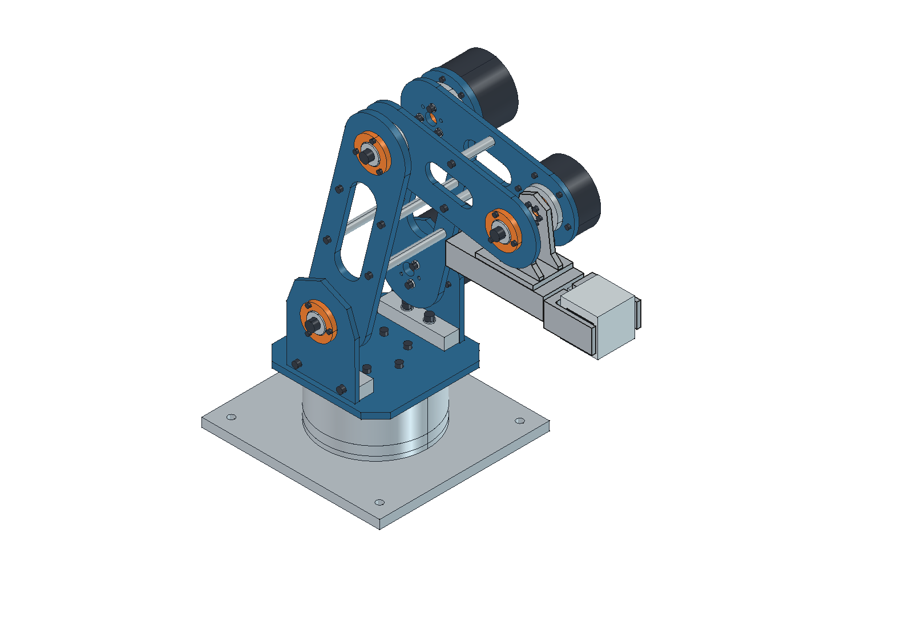
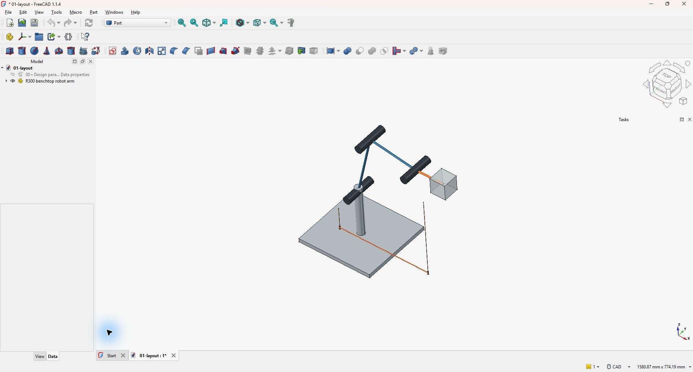
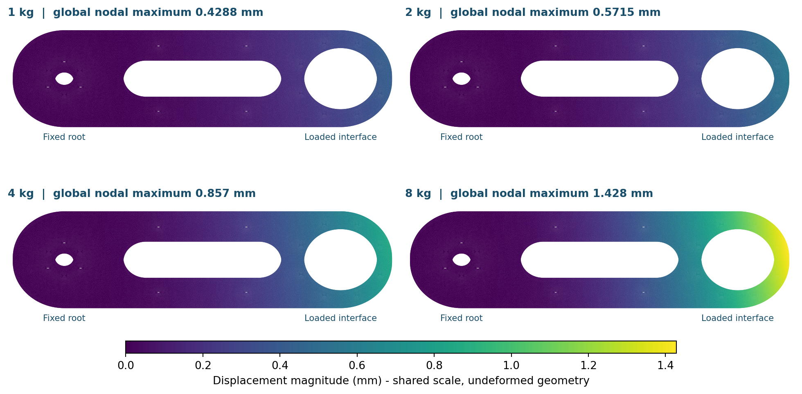

# A robot arm designed with Codex

<!-- Randy's introduction goes here. -->

## What Codex did

I gave Codex a cube to pick up and a pose to hold it in. It laid out the arm in FreeCAD, chose motors it could actually look up, and modeled a gripper. I then asked it to take that first design and think through how the pieces would go together. It chose materials, sourced hardware, revised the joints, and put together a parts list.

For the last pass, I asked for a study I could open and change, not just a stress plot. Codex isolated one plate between the shoulder and elbow, kept the setup the same, and varied the weight of the cube. The image shows where the plate flexes in the model. The FreeCAD files let you see where the loads went and try moving one yourself.

## Open the files

- [CAD](cad/): Start with the [STEP assembly](cad/R300B.step) for a quick look, or open the [editable model](cad/R300B.FCStd) in FreeCAD. The [first design](cad/baseline/) is there if you want to see what changed.
- [FEM studies](fem/): Each payload has an editable FreeCAD case with the mesh, supports, loads, and results. The [opening and rerun guide](fem/README.md) starts with the lightest case and shows how to change a load on a copy.
- [Parts and sources](design/): The bill of materials, component references, and assembly notes.

## This was the definition of the project

Design an original benchtop robot arm with a gripper that can pick up a freestanding 1 kg cube, 50 mm on each side.

The arm should hold the cube in a bent pose: the upper arm angled slightly forward from vertical and the forearm sloping slightly downward toward the gripper. In that pose, the center of the cube should be 300 mm horizontally from the shoulder joint axis.

Use commercially available motors for the arm.

## The tasks I gave Codex

1. Complete the arm in FreeCAD

# Complete Robot Arm

Use scripts to build the robot arm model in FreeCAD. Save the editable FreeCAD model.

As you work, periodically bring up the FreeCAD window and take screenshots of a few major stages, including the initial layout and the completed assembly. Add a short caption to each. ThereΓÇÖs no need to capture every step.

Keep working until the whole arm is complete.

2. Revise it for fabrication and check the lift

# Make the R300 arm buildable and verify the 1 kg lift

Preserve the completed R300 baseline at commit `e6b570b`. Leave its CAD, scripts, and evidence intact. Work on a separately named copy and keep the revised outputs distinct.

Turn the copy into a design intended for real fabrication and assembly. Keep the original job: grip and lift the freestanding 50 mm, 1 kg cube from the bench and hold it in the specified bent pose, 300 mm horizontally from the shoulder axis. Use specified materials (grade and condition where relevant), commercially available components and hardware, and realistic fabrication and assembly details. Redesign where needed. Make the joints and gripper movable in the editable FreeCAD assembly, with defined travel limits.

- Provide a sourced bill of materials with quantities, part numbers or material specifications, supplier links, and an estimated build cost. Separate component prices from any estimated fabrication costs and flag exclusions.
- Define the motion range for carrying the cube. Check reach, clearance, grip retention, and actuator loads for pickup, lift, and hold. Screen loads across that range, including arm self-weight, and explain how you chose the governing poses and parts for FEA. No need to run FEA at every pose.
- Run focused FEA for those load cases, document how you applied the loads and constraints, check mesh sensitivity where it affects the conclusion, and compare stress and deflection against justified limits. Iterate the design and recheck affected results. Treat structural strength, motor capacity, and grip retention as separate questions.
- Deliver the revised editable FreeCAD assembly, STEP export, and a technical report with images, sources, calculations, FEA setup and results, and a record of what changed from the baseline and why. Distinguish what the analyses support from what still needs fabrication review or physical testing. Report any unmet criteria rather than claiming the arm is validated.

3. Make the payload study editable

# R300B: inspectable FreeCAD FEM payload study

Use the final R300B design at `cc9020d` as-is. This is a new assessment, not a redesign or an attempt to reproduce every result in the original report. Keep the existing CAD, reports, and solver files intact. Put the new study and its report in a separate folder.

Use the same 50 mm cube geometry and compare **exactly four payload cases**: the 1 kg design target and three heavier masses you choose and justify. Choose a representative or demanding pose from the defined lift and explain why. Keep the pose, modeled geometry, materials, supports, mesh approach, and non-payload loads consistent across the cases so the effect of changing payload is clear. Document any necessary departure from that comparison. Mesh refinement for numerical verification does not count as an additional payload case.

Run the analyses from editable **FreeCAD FEM project files** and save the actual `.FCStd` setups used for the reported runs. Make the materials, mesh, load locations and values, supports, and solver settings inspectable and editable in FreeCAD. Include any dependencies, inputs, and saved results needed to review and rerun the cases. Reopen the saved projects and verify that the reported cases can be rerun. In a separate copy, move or change a load through the FreeCAD interface, rerun it, and verify that the result changes. Give reviewers short, exact steps for both workflows. A result-only import or a report with screenshots is not a substitute for the editable setup.

Write a standalone FEM report that shows where the loads and supports are applied and how stress, strain, and deflection change with payload. Use comparable plots and a summary table. State the material data, assumptions, acceptance criteria, and mesh checks. Explain which modeled limit is reached first if one is reached, or what the tested range shows if none is reached. Screen motor torque, grip retention, and joint/interface limits separately where the available evidence supports it, and flag anything that could govern before the structure does. A limit predicted by the model is not a measured failure load or a payload rating. If a linear-elastic case exceeds its valid range, flag that rather than interpreting the result as a prediction of post-yield behavior.

